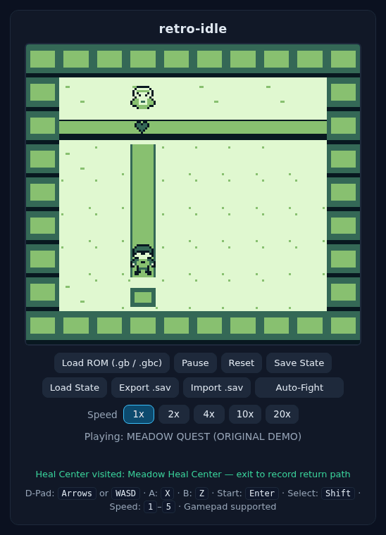

# retro-idle

Browser Game Boy / Game Boy Color emulator with built-in idle automation — play the fun parts, auto-grind the rest.

**Live demo:** <https://kssilveira.github.io/retro-idle/>



*Demo captured from the real `retro-idle` UI and [autofight.js](autofight.js) state machine using 100% original placeholder pixel art — no commercial ROM assets are included.*

## Features

- **Zero-build browser GB/GBC emulator** ([index.html](index.html)) powered by vendored MIT-licensed `binjgb` WASM.
- **ROM loading & auto-resume:** Load `.gb` / `.gbc` files via file picker, full-page drag-and-drop, or `?rom=<url>`. Your last ROM, auto-save state, and battery SRAM persist locally in `IndexedDB`.
- **Portable saves & states:** Manual **Save State** / **Load State**, plus **Export `.sav`** / **Import `.sav`** compatible with desktop emulators.
- **Emulator speed controls:** Switch between `1x`, `2x`, `4x`, `10x`, and `20x` speed via the UI buttons or number keys (`1`–`5`); audio automatically mutes above `1x`.
- **Mobile & touch support:** Automatically displays multi-touch Game Boy controls (thumb-slide D-Pad, B/A, Start/Select) on phones and tablets with responsive portrait & landscape handheld layouts, a manual **Touch Pad** toggle, mobile file-picker & touch audio unlock support, and Screen Wake Lock while playing.
- **Always-on-top Mini-Player:** Pop out an interactive Document Picture-in-Picture mini-player window on desktop Chrome/Edge with live Pause/Resume, Auto-Fight, and speed controls, Auto-Fight / Heal Center status, full keyboard input forwarding, and continuous background playback while the main tab is hidden.
- **Pokémon Red / Blue / Yellow / Crystal Auto-Fight** ([autofight.js](autofight.js)):
  - Automatically enabled when a `POKEMON RED`, `POKEMON BLUE`, `POKEMON YELLOW`, or Pokémon Crystal (`PM_CRYSTAL`) ROM is loaded.
  - Paces back and forth around your starting tile (rotating directions if blocked) and fights wild encounters by selecting `FIGHT` and your first attacking move with `PP > 0` (skipping non-damaging moves like Growl or False Swipe).
  - **Automatic Heal Center heal-and-return:** Passively records a loop-pruned path from the most recently visited Heal Center (shown live below the Auto-Fight status when visited and how many steps are active). When out of PP, Auto-Fight flees wild battles, walks back to heal with the healer, returns to your grinding spot, and resumes fighting. If your party faints with an active Heal Center path, Auto-Fight switches to another healthy party Pokémon or recovers from the Heal Center blackout spawn and walks back to your grinding spot automatically.
  - **Crystal shiny & uncaught stops:** Always stops immediately on **shiny** Gen 2 wild encounters (`shiny encounter`), and stops on **uncaught** Pokédex species (`uncaught encounter`) while **Stop: Uncaught** is toggled on (click to switch between `Stop: Uncaught` and `Fight: Uncaught`).
  - Automatically stops and releases all buttons on **out of PP or fainting without a visited Heal Center** (`missing Heal Center path`), **blackout to a different location** than the tracked Heal Center, **one-way ledge / blocked path** (prompting you to use a returnable path next time), **learning a move**, entering a **trainer battle**, or **unexpected map change** (or when you press `Escape` or click **Stop Auto-Fight**).

## Roadmap

- [x] **Pokémon Red / Blue** (GB) — Auto-Fight & automatic Heal Center round-trip
- [x] **Pokémon Yellow** (GB / GBC) — Auto-Fight & automatic Heal Center round-trip
- [x] **Pokémon Crystal** (GBC) — Gen 2 WRAM driver (`(mapGroup, mapNum)`), battle/move menus, Heal Center round-trip, and shiny/uncaught encounter stops
- [ ] **Pokémon Emerald** (GBA) — Add a GBA WASM core (e.g. `mGBA`) + Gen 3 Auto-Fight, Heal Center loop, and Gen 3 idle grinds (EV training, egg hatching, shiny stops)

## Controls

| Action | Input |
| :--- | :--- |
| D-Pad | `Arrow Keys` or `WASD` |
| A / B | `X` / `Z` |
| Start / Select | `Enter` / `Shift` or `Tab` |
| Speed (1x–20x) | `1`–`5` |
| Stop Auto-Fight | `Escape` |
| Gamepad | Standard Gamepad API mapping |

## Run Locally & Test

Requires `python3`, `node` (v24+), and `google-chrome` (for browser verification):

```bash
# Serve at http://127.0.0.1:8000/
./serve.sh

# Optional: launch Chrome with CDP debugging on port 9222
./open-chrome.sh

# Run Auto-Fight unit tests
node --test tests/autofight.test.mjs

# Run end-to-end headless Chrome emulator verification
node tests/verify.mjs
```

## Copyright Notice

- **No copyrighted ROMs, BIOS dumps, or game assets are included.** Bring your own legally obtained `.gb` / `.gbc` ROMs; everything runs 100% client-side in your browser.
